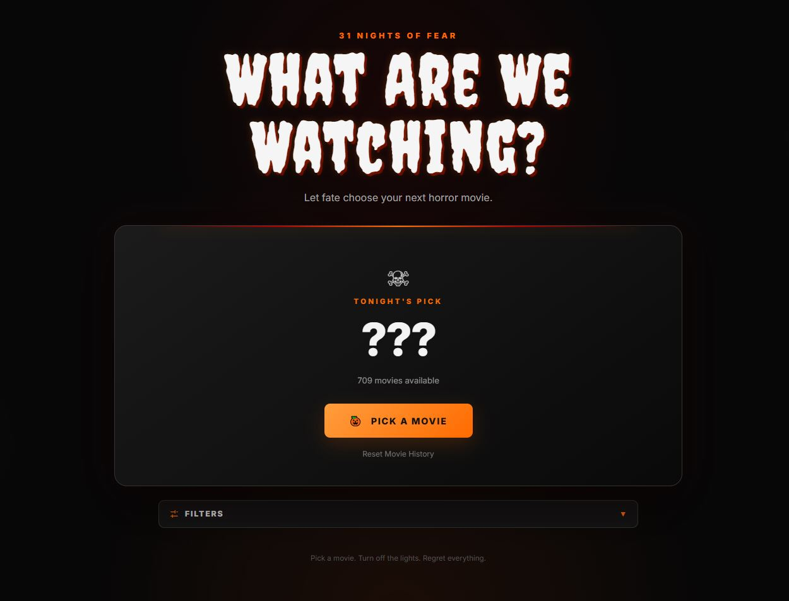

# 🎃 31 Nights of Fear

### An Interactive Horror Movie Generator

**Can't decide what horror movie to watch? Let fate decide.**

31 Nights of Fear is an interactive horror movie recommendation application built entirely with **HTML, CSS, and vanilla JavaScript**.

The application randomly selects movies from a curated collection of over **700 horror films**, featuring customizable genre filters, non-repeating selections, movie ratings, and direct IMDb links.

Designed with a Halloween-inspired interface, the application makes discovering your next horror movie simple, interactive, and fun.

### [🎬 Try the Live Application](https://goobergreve09.github.io/Scary-Movie-Generator/)

---

## 📸 Application Preview



*An interactive horror movie generator featuring randomized recommendations, movie ratings, and genre filtering.*

---

## ✨ Features

### 🎲 Random Movie Selection

- Randomly selects a movie from a curated collection of over 700 horror films.
- Displays the selected movie's title, release year, and available ratings.
- Provides a quick way to discover movies without endlessly browsing streaming platforms.

### 🔁 Non-Repeating Selection System

- Tracks previously generated movies during the current run.
- Removes selected movies from the available selection pool.
- Prevents repeated recommendations until the pool is exhausted or the history is reset.
- Displays the number of movies remaining in the current pool.

### 🎭 Genre Filtering

Narrow recommendations by horror subgenre:

- Classic
- Slasher
- Supernatural
- Psychological
- Creature
- Zombie
- Found Footage
- Comedy
- Sci-Fi

### ⭐ Movie Ratings & IMDb Integration

- Displays IMDb and Rotten Tomatoes ratings when available.
- Provides clickable movie titles that open their corresponding IMDb pages.
- Uses verified IMDb title IDs when available.
- Falls back to IMDb title search when a verified ID is unavailable.

### ⚠️ Content Warnings

- Displays conditional content warnings for selected films with particularly extreme or disturbing material.
- Keeps warnings separate from standard movie information for improved readability.

### 🎨 Custom Horror-Themed Interface

- Halloween-inspired typography, colors, and visual styling.
- Dynamic movie information updates without page reloads.
- Interactive controls for generating recommendations, filtering movies, and resetting selection history.

---

## 🛠️ Technologies Used

| Technology | Purpose |
|---|---|
| HTML5 | Application structure and semantic markup |
| CSS3 | Styling, layout, and visual presentation |
| JavaScript (ES6+) | Randomization, filtering, selection history, and DOM manipulation |
| Git & GitHub | Version control and source code management |
| GitHub Pages | Static website hosting and deployment |

**No frontend frameworks or backend services required.** The application runs entirely in the browser.

---

## 🧠 Technical Highlights

### Non-Repeating Randomization

Rather than repeatedly selecting from the entire movie database, the application manages a pool of available movies.

Each selected movie is removed from the current pool, preventing duplicate recommendations during a run. Users can reset their movie history to restore the available selection pool.

### Dynamic DOM Manipulation

JavaScript updates the interface based on user interactions, including selected movie details, available movie counts, ratings, and content warnings.

### Data-Driven Architecture

Movie information is organized separately in `movies.js`, making it straightforward to maintain and expand the collection without rewriting application logic.

### IMDb Navigation

The application uses stored IMDb identifiers for verified movie links and falls back to IMDb title search when a verified identifier is unavailable.

---

## 🚀 Getting Started

No installation, build process, or additional dependencies are required.

### Option 1: Use the Live Application

Visit [31 Nights of Fear](https://goobergreve09.github.io/Scary-Movie-Generator/).

### Option 2: Run Locally

1. Clone the repository:

   ```bash
   git clone https://github.com/Goobergreve09/Scary-Movie-Generator.git
   ```

2. Open the project directory.

3. Open `index.html` in your browser.

---

## 📁 Project Structure

```text
Scary-Movie-Generator/
├── Assets/
│   └── images/
│       └── app-preview.png
├── index.html
├── style.css
├── script.js
├── movies.js
└── README.md
```

### Core Files

- `index.html` — Application structure and user interface.
- `style.css` — Horror-themed styling and layout.
- `script.js` — Randomization, filtering, movie history, and interaction logic.
- `movies.js` — Curated movie dataset and associated metadata.

---

## 🎬 Expanding the Movie Collection

The movie database is maintained in `movies.js`. Additional films can be added by creating new movie objects following the existing data structure.

Example:

```javascript
{
  title: "Movie Name",
  genre: "slasher"
}
```

**Supported genres:**

`classic`, `slasher`, `supernatural`, `psychological`, `creature`, `zombie`, `found-footage`, `comedy`, `sci-fi`

Additional movie metadata can be included according to the existing data format.

---

## 💡 Project Motivation

I developed 31 Nights of Fear as a personal project to combine my interest in horror movies with practical JavaScript development.

The project provided an opportunity to work with structured datasets, randomized selection algorithms, conditional rendering, DOM manipulation, and interactive user interface design without relying on a JavaScript framework.

---

## 🔗 Links

- **Live Application:** [31 Nights of Fear](https://goobergreve09.github.io/Scary-Movie-Generator/)
- **Source Code:** [GitHub Repository](https://github.com/Goobergreve09/Scary-Movie-Generator)

---

*Built with HTML, CSS, JavaScript, and a love for horror movies.* 🎃
